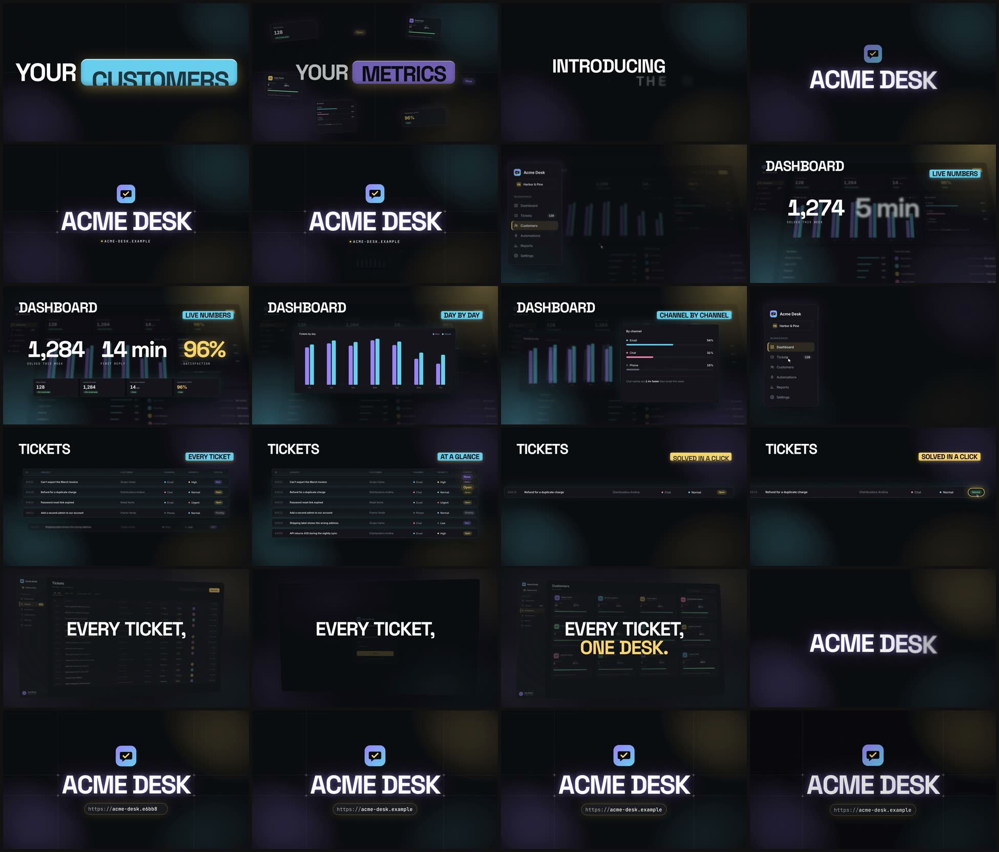

# Example · Acme Desk

A fictional helpdesk app and its launch video, end to end. Use it to see the method working before you point it at your own product, and as the quality bar for the visual language.



| Folder | What's in it |
|---|---|
| `app/` | The demo product: a static, hash-routed app (Dashboard, Tickets, Customers, login) that reads everything from `/api/*`. Plain HTML/CSS/JS, Inter font (OFL). It never talks to a real backend: during the capture, `/api/*` is answered by `video/capture/demo-data.mjs`. |
| `video/` | The video project, set up with `tools/new-video.mjs` and filled in: capture config, four scenes, storyboard, copy in en/es, placeholder music. Its README explains how it's generated and the content decisions. |
| `snapshots/` | Frames of the final render: a 24-frame contact sheet and 15 frames at 960 px. |
| `review/` | `tools/review.mjs` on the render: report (cuts against the beat grid, still stretches, loudness), filmstrip, contact sheet. |

Run it:

```bash
npm install
npm run video:capture
node video/render.mjs --lang en --quality draft --name acme-desk
```

Everything on screen is invented: Acme Desk, the "Harbor & Pine" account, its customers, agents and tickets.
